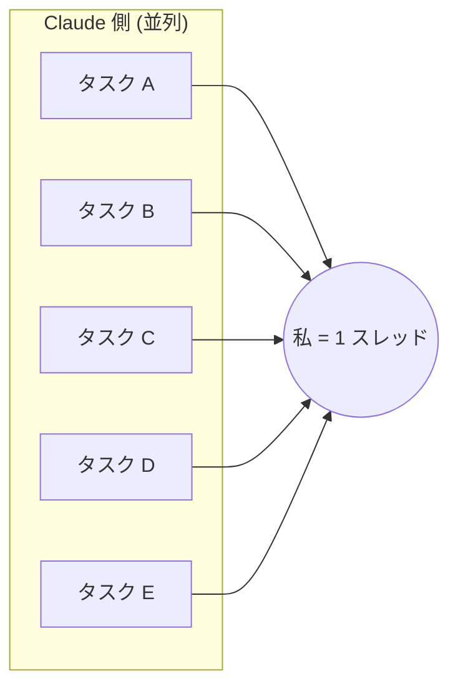

## Claude でタスクは 3 倍になったのに、消化できなくなった

Claude を業務で使い始めてから、抱えるタスクの量が増えました。チケット数・案件数・PR 数のどれで見ても、**Claude を使う前の 3 倍近く**になっています。

1 つあたりの作業は確実に速くなっています。それなのに、1 日の終わりに残タスクを見ると、ほとんど減っていません。「今日も全然タスクを消化できなかったな」と落ち込む日が続きました。

原因を探した結果、行き着いたのは **AI ではなく、人間である私の側の無駄** でした。並列でこなしているつもりで、実際には 1 本のスレッドで切り替えを繰り返していただけです。

この記事では、そう気づいた経緯と、切り替えを減らすために今やっている運用を書きます。

| やったこと | 中身 |
|---|---|
| 通知を絞る | 私用 iPhone の通知と、業務チャットのうち優先度の低いものを切る |
| 切り替え時に引き継ぎメモを残す | Apple 純正メモに「どこまで完了したか / 次に何をするか / 完了条件」の 3 点を書く |
| 終業時に明日の自分へ指示メモを残す | 同じ 3 点の形式で、翌朝の最初の一手を書いておく |
| 計画を作業の前に済ませる | Claude の Plan モードで、要件が満たされるまで計画を詰めてから着手する |
| 作業中は他のことを考えない | 計画はもう済んでいるので、手を動かすだけにする |

結果として、**集中力が上がり、1 日の進捗が良くなりました**。ただし数値で測ったわけではなく、体感です。この点は最後にもう一度触れます。

## 並列でこなしているつもりが、実際は 1 本のスレッドで切り替えていた

当時の働き方は、**5 本のタスクを同時に走らせる** というものでした。Claude に 1 本目の実装を任せている間に 2 本目の調査を頼み、その間に 3 本目のレビューを見る、という具合です。

Claude の側は本当に並列に動いています。問題は、それぞれの結果を受け取り、判断し、次の指示を出すのが私 1 人だったことです。



5 本のタスクが返ってくる先は、全部同じ私です。私が A の結果を読んでいる間、B〜E は待っています。A から B に移るときは、「B は何をするタスクで、どこまで進んでいて、次に何を判断すべきか」を頭に読み込み直す必要があります。

これはまさに、CPU 1 コアで複数のプロセスを動かすときのコンテキストスイッチです。同時に動いているように見えて、実際には 1 つずつ順番に処理していて、切り替えるたびに状態の退避と復元が発生します。**私はマルチタスクをしていたのではなく、シングルスレッドでコンテキストを切り替え続けていた** わけです。

タスクが 3 倍になったことで切り替えの回数も増えました。1 つあたりの作業は Claude のおかげで短くなっても、切り替えのコストは私の側に残ったままです。進捗率が悪かったのは、このためだと考えています。

## 切り替えには毎回コストがかかる

人がタスクを切り替えると時間のコストがかかることは、心理学の実験でも確かめられています。

Rubinstein, Meyer, Evans (2001) は 4 つの実験で、参加者に異なるタスクを交互に行わせる場合と、同じタスクを繰り返させる場合を比べました。結果は次のとおりです。

- タスクを切り替えると、**切り替えにかかる時間のコストが発生した**
- そのコストは、**ルールが複雑なほど大きくなった**
- **次に何をやるかの手がかりがあると、コストは小さくなった**

出典: [Executive control of cognitive processes in task switching](https://pubmed.ncbi.nlm.nih.gov/11518143/) (Journal of Experimental Psychology: Human Perception and Performance, 2001)

実験で使われたのは図形の分類や算数の問題なので、実務にそのまま当てはまるとは限りません。それでも、3 つ目の「手がかりがあるとコストが下がる」は、後で書く引き継ぎメモの考え方とよく合っています。

:::message
「マルチタスクで生産性が◯%落ちる」といった数字がよく引用されますが、一次資料を確認できなかったため、この記事では使っていません。
:::

## 通知を最低限に絞る

最初に見直したのは通知です。通知が来て内容を確認するだけでも、頭はそちらに切り替わります。返信しなくても、「何だったか」を読んだ時点で、作業中だったタスクの状態は一度頭から追い出されています。

切ったのは次の 2 つです。

| 対象 | 対応 |
|---|---|
| 私用の iPhone の通知 | 業務中は切る |
| 業務チャットのうち、優先度の低いもの | 通知を切り、自分のタイミングでまとめて見る |

業務チャットの通知を全部は切っていません。すぐに反応すべき連絡まで止めると、別の問題が起きるからです。**「今すぐ反応しないと困るもの」だけを残す** という基準で絞りました。

## 切り替えるときは、自分宛ての引き継ぎメモを残す

それでも、タスクを切り替えなければならない場面はあります。差し込みの依頼、別タスクのレビュー待ちが解けた、などです。

そのときは、**切り替える前に、今のタスクの引き継ぎメモを書いてから離れます**。他人に作業を引き継ぐときに書くメモを、未来の自分に向けて書くイメージです。

置き場所は Apple 純正のメモアプリです。専用のツールは使っていません。すぐ開けて、すぐ書けることを優先しました。

書く内容は 3 点に固定しています。

```text:引き継ぎメモの型
（どこまで）まで完了した。
次は（何）のテストを行う。
（条件）が満たされれば完了とする。
```

| 項目 | 役割 |
|---|---|
| どこまで完了したか | 戻ってきたときに、どこから再開するかが分かる |
| 次に何をするか | 最初の一手を考えずに始められる |
| 完了条件 | 何を満たせば終わりかが分かり、やりすぎや手戻りを防ぐ |

ポイントは **「次に何をするか」を具体的に書くこと** です。戻ってきたときに一番時間がかかるのは、「さて、何をするんだったか」を思い出す部分です。メモに次の一手が書いてあれば、読んだ瞬間に手を動かせます。

先ほどの実験で「次に何をやるかの手がかりがあるとコストが下がる」とあったのは、まさにこの部分です。

型を 3 点に固定しているのは、書く側の負担を減らすためでもあります。引き継ぎメモを書くこと自体が重くなると、書かずに離れるようになるからです。

## 1 日の終わりに、明日の自分への指示メモを残す

同じことを 1 日の終わりにもやっています。業務を終える前に、**明日の自分に向けた指示メモ** を残します。形式は引き継ぎメモと同じ 3 点です。

一晩空くと、前日の頭の中はほぼ消えています。以前は、朝の最初の時間を「昨日どこまでやったか」を思い出すことに使っていました。指示メモがあると、朝はメモを読んで、書いてあるとおりに始めるだけで済みます。

前日の自分は、そのタスクの状態を一番よく知っている人です。その人から指示をもらって始められるので、朝の立ち上がりが速くなりました。

## 計画は作業の前に済ませ、作業中は「やるだけ」にする

もう 1 つ大きかったのは、**計画と作業を分けた** ことです。

### とりあえず着手すると、実装が止まり続ける

以前は、とりあえず手を付けてから考えることが多くありました。実際にあった失敗がこれです。

ある機能を実装しようとしたとき、要件が確定していない状態で着手しました。進めるうちに「この場合、どっちにすればいいんだろう」という分岐に何度も行き当たり、**そのたびに実装が止まりました**。

止まるたびに、私は作業モードから計画モードに頭を切り替えて考え込みます。結論が出たら作業モードに戻ります。これも 1 本のタスクの中で起きているコンテキストスイッチです。さらに、後から決めた判断が先に書いたコードと合わず、出戻りも発生しました。

### Plan モードで、要件が満たされるまで計画を詰める

今は、複数のタスクを同時に進めるときほど、**着手する前に作業計画を立て、あとはやるだけの状態にしてから** 始めています。

計画には Claude の Plan モードを使っています。Plan モードで計画を出させ、**要件が満たされるまで** 詰めます。「この場合はどっちにするか」という分岐は、この段階で全部潰しておきます。

計画が固まってから作業に入れば、作業中に判断で止まることがほとんどなくなります。脳のリソースを「何をするか」の判断に使わず、手を動かすことだけに使えます。

### 作業中に他のことは考えない

計画と作業を分けたことで、もう 1 つルールを置けるようになりました。**作業中は他のことを考えない** というものです。

作業中に別のタスクのことや、まだ決まっていない計画のことを考え始めると、それもコンテキストの切り替えになります。計画を作業前に済ませておけば、作業中に考えるべきことは目の前の作業だけになります。

## やってみて変わったこと

運用を変えてから変わったのは、次の 2 点です。

- **集中力が上がった**。作業中に通知や判断で中断されることが減り、1 つのタスクに集中していられる時間が長くなった
- **1 日の進捗が良くなった**。終業時に「今日も全然終わらなかった」と落ち込むことが減った

正直に書くと、これは **体感** です。運用の前後で消化したチケット数を比べるような計測はしていません。抱えているタスク量そのものも、前後で同じ条件ではありません。

それでも、落ち込んでいた原因が「Claude が遅いから」でも「自分の能力が足りないから」でもなく、**切り替えの多さという仕組みの問題だった** と分かったことは大きかったです。仕組みの問題なら、仕組みで直せます。

## まとめ

- Claude でタスクが 3 倍近くに増え、5 本を並列で回していたが、消化は進まなかった
- 原因は、人間の私が 1 本のスレッドでコンテキストを切り替え続けていたこと
- 通知を絞り、切り替え時と終業時に「完了したところ / 次の一手 / 完了条件」の 3 点メモを残すようにした
- Claude の Plan モードで要件が満たされるまで計画を詰め、作業中はやるだけにした
- 集中力と 1 日の進捗は良くなったが、数値では測っていない

明日から 1 つだけ試すなら、**今のタスクを離れる前に、3 行の引き継ぎメモを書く** ことです。特別なツールは要らず、手元のメモアプリで足ります。
